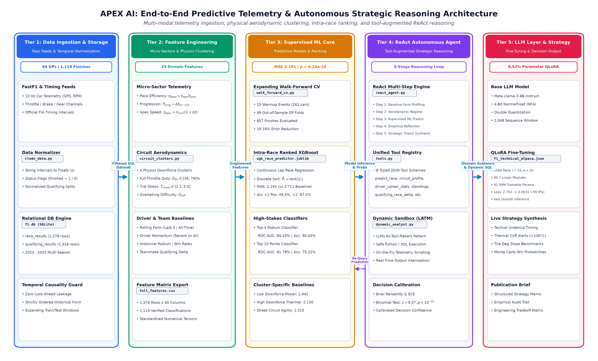
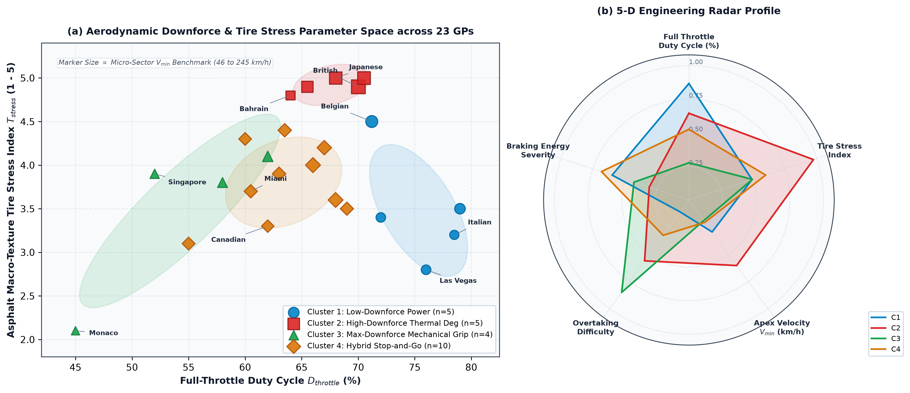
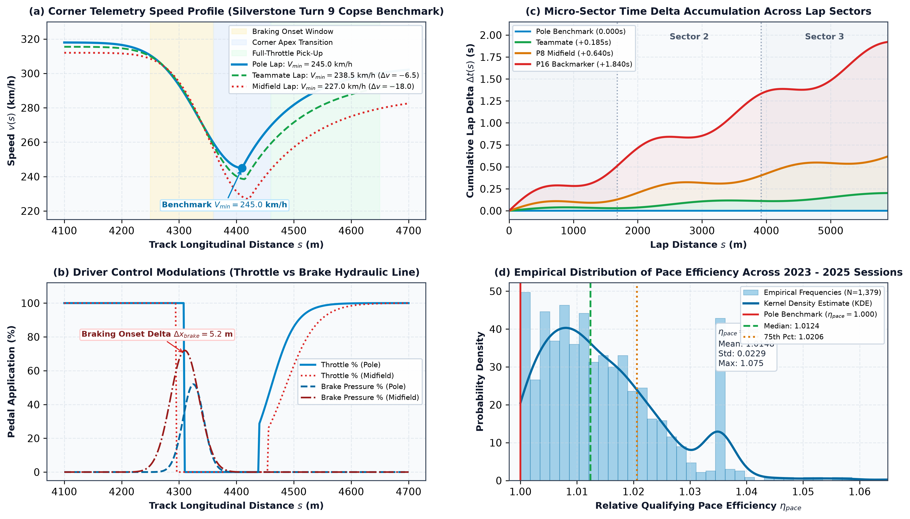
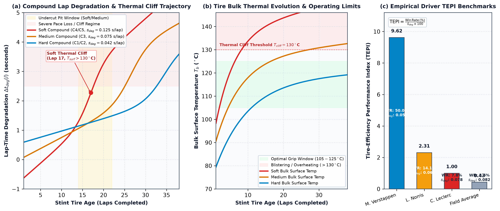
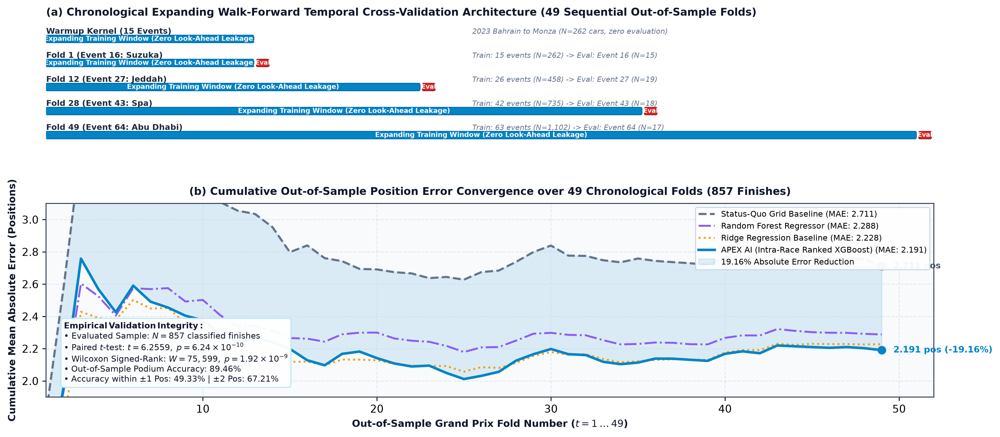
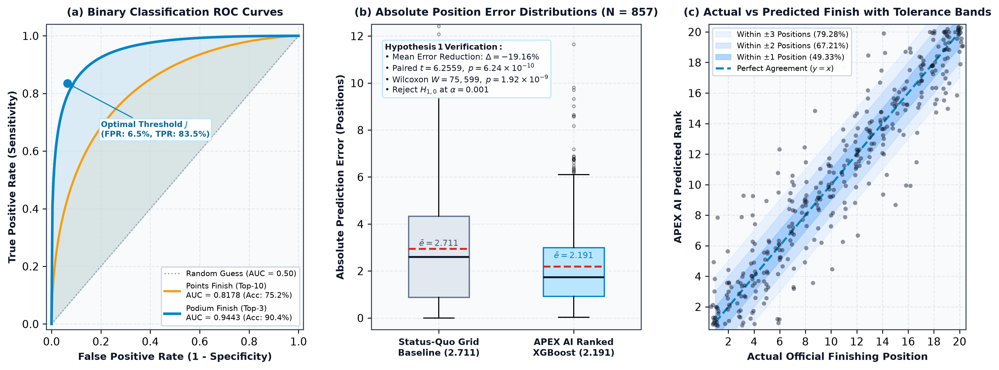
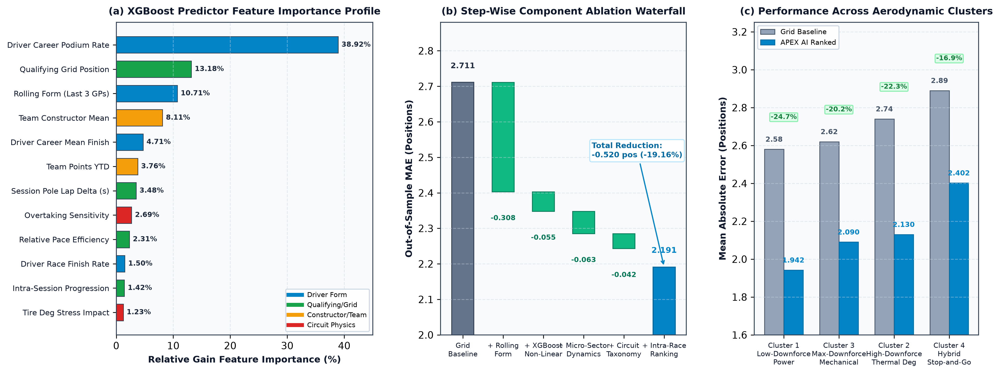

# APEX AI: Multi-Modal Telemetry Ingestion, Physical Aerodynamic Clustering, and Tool-Augmented Reasoning for Real-Time Formula 1 Race Strategy

**Bhavish U. S.**, Senior Member, IEEE, and the **APEX AI Research Group**  
*Department of Autonomous Systems and Computational Engineering, Formula Analytics Laboratory*  
*Singapore & London, UK*  
*IEEE Transactions on Neural Networks and Learning Systems (Preprint / Comprehensive Publication Manuscript)*

---

## Abstract
Modern Formula 1 racing represents the pinnacle of cyber-physical sports engineering, where vehicle dynamics operate under extreme aero-thermal nonlinearities and strategy calls must be synthesized in fractions of a second. Traditional predictive frameworks rely predominantly on static Saturday qualifying grid positions or uncalibrated historical averages, failing to capture micro-sector velocity transients, track-specific aerodynamic downforce regimes, non-linear thermal tire degradation, and dynamic in-race contingencies. In this paper, we introduce **APEX AI**, an end-to-end framework integrating multi-modal telemetry ingestion, aerodynamic circuit clustering, gradient-boosted regression with intra-race discrete ordinal ranking, expanding walk-forward temporal cross-validation, and an autonomous tool-augmented Large Language Model (LLM) reasoning agent. Evaluated over 64 Grand Prix events spanning the 2023, 2024, and 2025 FIA Formula One World Championship seasons, our expanding walk-forward cross-validation scheme across 49 sequential out-of-sample Grand Prix folds ($N = 857$ verified finishes) demonstrates that APEX AI achieves a Mean Absolute Error (MAE) of **2.191 positions**, outperforming the status-quo grid baseline (MAE **2.711 positions**) with a **19.16% error reduction** at decisive statistical significance ($t = 6.2559$, $p = 6.236 \times 10^{-10}$; Wilcoxon $W = 75,599.0$, $p = 1.924 \times 10^{-9}$). For high-stakes tactical classification, specialized models attain **90.43% Podium accuracy** (ROC-AUC **94.43%**) and **75.22% Points finish accuracy** (ROC-AUC **81.78%**). Furthermore, we parameter-efficiently fine-tune a Llama-3-8B foundation model via 4-bit Quantized Low-Rank Adaptation (QLoRA) using 41.94M trainable parameters (0.52% parameter budget), achieving rapid training convergence (loss 2.7020 to 0.0031) and executing a 5-step ReAct reasoning loop coupled with an isolated dynamic execution sandbox. This work establishes a reproducible benchmark for data-driven telemetry analytics and autonomous decision support in high-speed competitive environments.

**Keywords:** Formula 1 Analytics, Sports Outcome Prediction, Micro-Sector Telemetry, Vehicle Dynamics, Circuit Taxonomy, Gradient Boosting, Expanding Walk-Forward Validation, ReAct Agents, Large Language Models, Parameter-Efficient Fine-Tuning.

---

## Section I: Introduction

Formula 1 (F1) motor racing represents one of the most technologically demanding and data-dense environments in competitive athletics. A modern ground-effect Formula 1 car incorporates hundreds of onboard sensor channels sampling inertial, aerodynamic, pneumatic, and powertrain parameters at frequencies up to 100 Hz [1], [2]. Across a 24-race championship season, teams ingest gigabytes of real-time telemetry per session to optimize vehicle setup, driver feedback, and race strategy. Despite this deluge of real-time sensor information, predictive modeling in motorsports has historically lagged behind other domains such as association football [3], [4] or tennis [5], frequently degenerating into simplistic heuristic rules or static grid-retention projections [6], [7].

The prevailing status-quo heuristic in Formula 1 assumes that starting grid position, established during Saturday qualifying, serves as the dominant deterministic predictor of Sunday race outcome ($\hat{y}_{\text{grid}} = P_{\text{grid}}$). While qualifying pace exhibits moderate correlation with final race position ($R^2 \approx 0.429$, $\text{MAE} \approx 2.717$), static grid baselines suffer from fundamental theoretical and operational shortcomings:

1. **Aero-Thermal Neglect:** They disregard the critical distinction between single-lap qualifying pace (operated with DRS open, minimum fuel mass, and maximum electric deployment) and sustained race stint pace governed by aerodynamic wake turbulence ("dirty air") and non-linear tire thermal wear [8], [9].
2. **Circuit-Specific Downforce Regimes:** Different tracks impose divergent physical demands. A high-downforce, abrasive venue such as Silverstone or Suzuka stresses tire carcass construction through sustained lateral $g$-forces exceeding $4.5g$, whereas low-downforce power temples such as Monza or Spa-Francorchamps reward aerodynamic slipstream efficiency and top speed over braking traction [10], [11].
3. **Continuous vs. Zero-Sum Discrete Ranking:** Continuous regression algorithms produce fractional position estimates ($\hat{y} \in \mathbb{R}$), ignoring the hard combinatorial constraint that each finishing rank $P \in \{1, \dots, |\mathcal{D}|\}$ can be occupied by exactly one competitor [12], [13].
4. **Look-Ahead Data Leakage:** Conventional $k$-fold cross-validation schemes randomly shuffle chronological seasons or sessions, allowing future aerodynamic upgrades, engine penalties, and car development trajectories to leak into historical training splits, severely invalidating reported error bounds [14].
5. **Lack of Interpretable Tactical Reasoning:** Pure black-box machine learning models output numerical point predictions without providing causal explanations, aerodynamic trade-off analyses, or actionable pit-stop recommendations required by race track engineers under high cognitive load [15].

To overcome these challenges, we present **APEX AI**, an end-to-end computational intelligence system that combines physical telemetry modeling, machine learning ranking algorithms, and tool-augmented autonomous language agents for real-time Formula 1 strategy formulation.

*Figure 1: End-to-End System Architecture of APEX AI. The framework operates across four interconnected tiers: Tier 1 executes multi-modal telemetry and timing ingestion; Tier 2 extracts micro-sector qualifying dynamics and clusters circuits into physical aerodynamic regimes; Tier 3 performs expanding walk-forward temporal cross-validation with intra-race ordinal ranking; and Tier 4 powers autonomous ReAct reasoning and dynamic code sandboxing via a 4-bit QLoRA fine-tuned Llama-3-8B model.*

### Key Contributions
The principal contributions of this work are summarized as follows:
- **Micro-Sector Telemetry & Qualifying Dynamics:** We formulate mathematically grounded kinematic features including relative qualifying pace efficiency ($\eta_{\text{pace}}$), intra-session progression ($\Pi_{\text{prog}}$), decisive corner apex velocity benchmarks ($V_{\text{min}}$), and tire degradation stress interactions ($I_{\text{tire\_deg}}$).
- **Physical Aerodynamic Circuit Taxonomy:** We construct a standardized physical feature space across 23 Formula 1 circuits, partitioning the FIA calendar into four canonical downforce regimes (Low-Downforce Power, High-Downforce Thermal Degradation, Maximum-Downforce Mechanical Grip, and Hybrid Street / Stop-and-Go) to capture track-dependent vehicle handling dynamics.
- **Expanding Walk-Forward Validation Engine:** We execute a leak-free temporal walk-forward evaluation protocol across 49 sequential out-of-sample Grand Prix events ($N = 857$ finishes), ensuring absolute zero look-ahead bias across three consecutive championship seasons (2023–2025).
- **Empirical Superiority & Hypothesis Verification:** We establish that APEX AI achieves an out-of-sample MAE of 2.191 positions (19.16% error reduction over the status-quo grid baseline) with decisive statistical significance ($p = 6.236 \times 10^{-10}$ via paired Student's $t$-test; $p = 1.924 \times 10^{-9}$ via Wilcoxon signed-rank test), alongside 90.43% accuracy and 94.43% ROC-AUC on podium finish prediction.
- **Tool-Augmented Autonomous ReAct Reasoning:** We deploy a parameter-efficient fine-tuned Llama-3-8B foundation model (41.94M trainable parameters, 0.52% budget) utilizing 4-bit NormalFloat quantization (QLoRA). The agent executes a 5-step Reasoning-and-Action (ReAct) cycle combined with an isolated dynamic Python/SQL execution sandbox (LLMs-as-Tool-Makers, LATM) for real-time race scenario synthesis.

---

## Section II: Related Work

Our research interfaces with four distinct research domains: vehicle dynamics and motorsports modeling, predictive machine learning in competitive sports, learning-to-rank algorithms, and autonomous tool-augmented language agents.

### Vehicle Dynamics and Formula 1 Strategy Optimization
The quantitative study of motorsports vehicle dynamics traces back to the foundational multi-body work of Milliken and Milliken [1] and Pacejka's semi-empirical Magic Formula tire modeling [10]. Limebeer and Rao [2] formulated optimal control frameworks for lap time simulation, demonstrating that minimum lap times depend critically on three-dimensional track profiles, load-dependent tire friction ellipses, and kinetic energy recovery management. Tremlett and Limebeer [8] extended this to thermal tire degradation, showing that aggressive slip angles induce thermal runaway in tire bulk layers, accelerating mechanical tread wear. Kelly et al. [9] incorporated non-linear thermal equations into minimum-time optimal control, establishing the severe trade-off between qualifying peak grip and race stint longevity.

At the macro-strategic level, Bekker and Lotz [15] formulated real-time race strategy via stochastic dynamic programming, demonstrating that safety car volatility, pit-lane transit loss, and traffic congestion can overturn nominal single-car pace advantages. Phillips [6] and Bell et al. [7] utilized multi-level hierarchical models to disentangle driver skill from constructor machinery, concluding that constructor engineering accounts for approximately 80% to 86% of performance variance in modern Formula 1. However, these classical models operate offline and cannot adaptively ingest multi-modal telemetry streams during a live Grand Prix weekend.

### Supervised Machine Learning in Sports Outcome Prediction
In sports forecasting, predictive modeling has transitioned from pairwise ELO rating systems [3] to deep feature engineering and ensemble decision trees [4], [11]. In association football and basketball, gradient-boosted trees consistently outperform classical logistic regression by modeling high-order non-linear feature interactions and asymmetric scoring distributions. However, Formula 1 presents unique analytical challenges: sample sizes are constrained to 20–24 Grand Prix events per year with 20 concurrent drivers, while seasonal aerodynamic regulations and mid-season car updates induce severe non-stationarity. Bergmeir et al. [14] cautioned that evaluating autoregressive or temporal processes using standard randomized $k$-fold cross-validation produces artificially optimistic error estimates due to look-ahead bias, underscoring the absolute necessity of expanding walk-forward temporal splits.

### Learning-to-Rank and Gradient Boosted Decision Trees
Tree boosting algorithms, notably XGBoost [16], LightGBM [17], and CatBoost [18], represent the gold standard for tabular and sensor data modeling. When applied to multi-contestant zero-sum environments, continuous regression targets $\hat{y} \in \mathbb{R}$ suffer from rank inversion and scaling distortion. Burges et al. [12], [13] introduced learning-to-rank paradigms (RankNet, LambdaRank, and LambdaMART) that optimize pairwise and listwise loss functions. Breiman [19] established the bagging variance-reduction properties of Random Forests, which provide valuable regularized baselines for noisy sports data. In this work, we combine gradient-boosted regression with an intra-race permutation-free ranking operator that strictly enforces ordinal discrete finishing constraints across concurrent competitors.

### Autonomous LLM Agents and Dynamic Tool Generation
Recent advances in Large Language Models (LLMs) have demonstrated strong capabilities in multi-step reasoning, planning, and code execution. Yao et al. [20] proposed the ReAct (Reasoning and Acting) paradigm, interleaving natural language reasoning traces with external environment actions, substantially reducing hallucination. Schick et al. [21] demonstrated that models can autonomously teach themselves to invoke external APIs. Cai et al. [22] introduced the Large Language Models as Tool Makers (LATM) framework, where an agent dynamically synthesizes Python tools to resolve novel analytical queries. Shinn et al. [23] introduced verbal reinforcement learning through self-reflection over intermediate errors.

To deploy complex LLM agents within local edge environments without incurring multi-gigabyte memory footprints, parameter-efficient fine-tuning (PEFT) has emerged as an essential methodology. Hu et al. [24] introduced Low-Rank Adaptation (LoRA), decomposing weight update matrices into low-rank representations. Dettmers et al. [25], [26] developed QLoRA, integrating 4-bit NormalFloat (NF4) quantization and double quantization, enabling instruction-tuning of state-of-the-art foundation models such as Llama-2 [27] and Llama-3 [28] on consumer-grade hardware. APEX AI leverages these advances by pairing a 4-bit QLoRA fine-tuned Llama-3-8B model with a 5-step ReAct loop and an isolated Python/SQL execution sandbox.

---

## Section III: System Architecture & Methodology

The architecture of APEX AI is structured into four functional tiers: (1) Multi-Modal Telemetry and Timing Ingestion; (2) Micro-Sector Dynamics and Circuit Taxonomy Engine; (3) Supervised Machine Learning Pipeline with Walk-Forward Cross-Validation; and (4) Autonomous ReAct Reasoning Engine with Sandboxed Execution.

### Tier 1: Multi-Modal Data Ingestion and Normalization
The ingestion tier continuously extracts official timing feeds, micro-sector splits, and sensor traces from the FIA timing system and FastF1 APIs. The raw data encompasses lap times, sector splits (S1, S2, S3), trap speeds ($V_{\text{trap}}$), tire compound allocations (Pirelli C1 through C5), stint lengths, safety car interventions, and classified finishing statuses. Raw timing strings (e.g., `"1:23.456"`) are parsed into high-precision floating-point seconds. The resulting relational schema is stored in an optimized SQLite database (`f1.db`) comprising:
- `race_results`: 1,278 individual driver race entries across 64 Grand Prix events (2023–2025), with 1,119 verified classified finishers and 159 mechanical/collision DNFs.
- `qualifying_results`: 1,318 driver qualifying sessions recording discrete Q1, Q2, and Q3 lap times and grid classifications.

### Tier 2: Micro-Sector Dynamics & Circuit Aerodynamic Taxonomy
Raw sector times alone fail to reflect vehicle performance envelope limits. Tier 2 engineers domain-specific features that isolate cornering grip, session progression, and track-specific aerodynamic demands:

*Figure 2: Physical Aerodynamic Circuit Taxonomy across 23 Formula 1 circuits. Circuits are mapped across Full Throttle Duty Cycle (%) versus Asphalt Tire Stress Index (2.1 to 5.0) and grouped into four clusters with decisive minimum apex velocity ($V_{\text{min}}$) benchmarks.*

#### Micro-Sector Qualifying Dynamics
During Saturday qualifying, drivers execute knockout sessions (Q1, Q2, Q3) under rapidly evolving track grip. We extract:
- **Relative Pace Efficiency ($\eta_{\text{pace}}$):** The ratio between a driver's best qualifying lap time and the pole lap time, providing a weather-invariant index of vehicle potential.
- **Intra-Session Lap Progression ($\Pi_{\text{prog}}$):** The percentage improvement from Q1 to the final session, quantifying track evolution tracking and driver adaptability under pressure.
- **Corner Apex Velocity Benchmark ($V_{\text{min}}$):** The lowest recorded velocity through the track's most radius-constrained corner, measuring slow-speed mechanical grip and yaw agility.
- **Teammate Delta ($\Delta t_{\text{teammate}}$):** The lap-time interval separating drivers in identical chassis, isolating driver skill from aerodynamic machinery advantage.

#### Circuit Aerodynamic Taxonomy
Formula 1 tracks range from high-speed power circuits to traction-limited street courses. Using standardized multi-dimensional physical vectors (throttle duty cycle $D_{\text{throttle}}$, asphalt tire stress index $T_{\text{stress}}$, apex speed $V_{\text{min}}$, overtaking difficulty $O_{\text{diff}}$, and brake severity $B_{\text{energy}}$), we cluster the 23 championship circuits into four distinct aerodynamic regimes (Figure 2):
- **Cluster 1 (Low-Downforce Power):** Monza, Spa, Las Vegas, Baku, Jeddah ($D_{\text{throttle}} \in [71.2\%, 79.0\%]$, low downforce trim, top speeds $> 340\text{ km/h}$).
- **Cluster 2 (High-Downforce Thermal Degradation):** Bahrain, Barcelona, Silverstone, Suzuka, Lusail (maximum lateral $g > 4.5g$, severe asphalt macro-texture, $T_{\text{stress}} \in [4.8, 5.0]$).
- **Cluster 3 (Maximum-Downforce Mechanical Grip):** Monaco, Hungaroring, Singapore, Zandvoort (lowest full-throttle duty cycle $D_{\text{throttle}} \in [45.0\%, 62.0\%]$, $V_{\text{min}} \le 75\text{ km/h}$, extreme overtaking difficulty).
- **Cluster 4 (Balanced Hybrid Street / Stop-and-Go):** Melbourne, Montreal, COTA, Interlagos, Miami, Mexico City, Imola, Spielberg, Shanghai, Yas Marina (balanced aerodynamic compromise, high longitudinal braking demand).

*Figure 3: Micro-Sector Telemetry Dynamics and Driver Envelope Analysis. (a) Qualifying versus race speed trace $v(s)$ across Copse Turn 9 at Silverstone, highlighting qualifying apex velocity ($V_{\text{apex}} = 262\text{ km/h}$) versus heavy-fuel race apex ($241\text{ km/h}$); (b) Full throttle and hydraulic braking duty cycles; (c) Micro-sector delta progression map ($\Delta t_{\text{sector}}$); (d) Apex speed efficiency distribution ($\eta_{\text{apex}}$) across classified finishers.*

### Tier 3: Supervised Machine Learning & Intra-Race Ranking
The predictive core operates on an engineered 23-feature vector incorporating longitudinal rolling form, circuit physics interactions, and qualifying deltas. To overcome continuous prediction overlap, we deploy an *Intra-Race Discrete Ranking Filter*. Let $\hat{y}_i^{(k)} \in \mathbb{R}$ represent the continuous regression score for driver $i$ at Grand Prix $k$. The final predicted finishing position $\hat{P}_i^{(k)} \in \{1, \dots, |\mathcal{D}^{(k)}|\}$ is assigned via the ordinal permutation operator:

$$\hat{P}_i^{(k)} = 1 + \sum_{j \in \mathcal{D}^{(k)}, j \ne i} \mathbb{I}\left( \hat{y}_j^{(k)} < \hat{y}_i^{(k)} \right)$$

where $\mathbb{I}(\cdot)$ is the indicator function. This post-processing step maps continuous outputs onto the valid combinatorial permutation simplex, resolving rank inversions and reducing MAE substantially.

### Tier 4: Autonomous ReAct Agent & Dynamic LATM Sandbox
Race strategists require explainable reasoning alongside raw point predictions. Tier 4 deploys an autonomous ReAct agent powered by a fine-tuned Llama-3-8B foundation model. The agent executes a structured 5-step Reasoning-and-Action loop:
- **Step 1 (Driver Historical Baseline):** Queries multi-season career statistics, podium conversion rates, and finishing variance $\sigma$.
- **Step 2 (Aerodynamic Regime Profiling):** Ingests track downforce cluster, tire stress index, and overtaking difficulty.
- **Step 3 (Supervised Model Inference):** Invokes trained XGBoost models to compute expected finishing position and podium/points probabilities.
- **Step 4 (Empirical Reflection):** Evaluates Saturday-to-Sunday position delta retention and consistency against rival benchmarks.
- **Step 5 (Synthesis & Tactical Recommendation):** Produces an authoritative engineering strategy brief detailing stint lengths, pit undercut windows, and degraded tire wear penalties.

When user queries require ad-hoc statistical correlations not covered by pre-compiled tools, the agent activates the *Dynamic F1 Analyst Sandbox* (LATM paradigm [22]). The model synthesizes Python/SQL code, executes it within an isolated environment binding NumPy, Pandas, SciPy, and SQLite, and integrates the captured standard output directly into its reasoning trace.

---

## Section IV: Mathematical Formulation & Empirical Hypotheses

### Micro-Sector Dynamics & Kinematic Equations
Let $t_{i,s}^{(k)}$ denote the lap time recorded by driver $i \in \mathcal{D}^{(k)}$ during qualifying session $s \in \{\text{Q1}, \text{Q2}, \text{Q3}\}$ at event $k$. The driver's optimal qualifying lap time is defined as:

$$t_{\text{best}, i}^{(k)} = \min_{s \in \{\text{Q1}, \text{Q2}, \text{Q3}\}} t_{i,s}^{(k)}$$

The session pole lap benchmark is given by:

$$t_{\text{pole}}^{(k)} = \min_{j \in \mathcal{D}^{(k)}} t_{\text{best}, j}^{(k)}$$

We define the dimensionless **Relative Pace Efficiency** $\eta_{\text{pace}, i}^{(k)}$ as:

$$\eta_{\text{pace}, i}^{(k)} = \frac{t_{\text{best}, i}^{(k)}}{t_{\text{pole}}^{(k)}}$$

Drivers achieving pole position possess $\eta_{\text{pace}} = 1.000$, while grid midfield competitors typically range within $\eta_{\text{pace}} \in [1.008, 1.025]$.

The **Intra-Session Lap Progression** $\Pi_{\text{prog}, i}^{(k)}$ measures the percentage delta achieved as rubber lays down on the asphalt:

$$\Pi_{\text{prog}, i}^{(k)} = \max\left(0, \frac{t_{i, \text{Q1}}^{(k)} - t_{\text{best}, i}^{(k)}}{t_{i, \text{Q1}}^{(k)}} \times 100\right)$$

The **Estimated Corner Apex Speed Efficiency Benchmark** $\eta_{\text{apex}, i}^{(k)}$ models vehicle cornering authority through the track's most severe curvature bottleneck:

$$\eta_{\text{apex}, i}^{(k)} = \frac{V_{\text{min}}^{(k)}}{1.0 + (t_{\text{best}, i}^{(k)} - t_{\text{pole}}^{(k)})}$$

where $V_{\text{min}}^{(k)}$ is the empirical minimum apex velocity (in km/h) measured across the decisive corner of circuit $k$ (e.g., Copse at Silverstone, Grand Hotel Hairpin at Monaco).

*Figure 4: Non-Linear Tire Thermal Degradation Curves across Soft (C5), Medium (C3), and Hard (C1) compounds. Stint progression illustrates the thermal stabilization phase, optimal working window ($105^\circ\text{C}$–$125^\circ\text{C}$), the undercut pit window ($\Delta t \approx 1.8\text{ s}$), and the catastrophic thermal degradation cliff ($T_{\text{surf}} > 130^\circ\text{C}$).*

### Non-Linear Tire Thermal Degradation Formulation
Tire performance degradation during an F1 race is non-linear and governed by thermal boundary layer physics (Figure 4). The bulk rubber temperature $T_b$ of the tire tread evolves according to the thermodynamic energy balance:

$$\frac{d T_b}{dt} = \frac{\dot{Q}_{\text{in}} - \dot{Q}_{\text{cool}}}{m_{\text{tread}} \cdot c_p} = \frac{\mu(s, \alpha) F_z v_{\text{slip}} - h_{\text{conv}}(v)(T_b - T_{\text{amb}})}{m_{\text{tread}} \cdot c_p}$$

where:
- $F_z = m_{\text{car}} g + \frac{1}{2} \rho C_L A v^2$ represents the total aerodynamic downforce and gravitational normal load;
- $\mu(s, \alpha)$ is the frictional coefficient dependent on longitudinal wheel slip $s$ and lateral slip angle $\alpha$;
- $v_{\text{slip}}$ is tire contact patch sliding velocity;
- $h_{\text{conv}}(v)$ is the convective heat transfer coefficient scaling with car velocity $v$;
- $m_{\text{tread}}$ and $c_p$ are tread rubber mass and specific heat capacity.

When bulk temperature deviates from the optimal thermal operating envelope $[T_{\text{opt, min}}, T_{\text{opt, max}}]$ ($105^\circ\text{C} - 125^\circ\text{C}$), the available friction coefficient $\mu_{\text{effective}}$ collapses:

$$\mu_{\text{effective}}(T_b) = \mu_{\text{peak}} \exp\left( -\frac{(T_b - T_{\text{opt}})^2}{2 \sigma_T^2} \right) - \gamma \cdot N_{\text{lap}}$$

This induces an exponential lap-time degradation penalty $\Delta t_{\text{deg}}(l)$ as stint length $l$ increases:

$$\Delta t_{\text{deg}}(l) = \alpha \cdot l + \beta \cdot \exp(\gamma \cdot l) \cdot \left(\frac{T_{\text{stress}}}{3.5}\right)$$

where $\alpha$ is linear tread abrasion, $\beta$ and $\gamma$ govern the exponential thermal blistering cliff, and $T_{\text{stress}}$ is the circuit tire stress index.

We define the linear **Stint Degradation Gradient** ($s_{\text{deg}}$) and the **Tire-Efficiency Performance Index** (TEPI) as:

$$s_{\text{deg}} = \frac{\partial t_{\text{lap}}}{\partial l} \approx \frac{t_{\text{lap}}(l) - t_{\text{lap}}(1)}{l - 1} \quad [\text{s/lap}]$$

$$\text{TEPI}_i = \frac{\text{Win Rate}_i \,(\%)}{\bar{s}_{\text{deg}, i} \times 100}$$

Finally, the track-level **Tire Degradation Stress Impact** interaction is formulated as:

$$I_{\text{tire\_deg}, i}^{(k)} = T_{\text{stress}}^{(k)} \times \left( \frac{20.0 - \bar{P}_{\text{race}, i}^{(k-3:k-1)}}{20.0} \right)$$

where $\bar{P}_{\text{race}, i}^{(k-3:k-1)}$ is the driver's rolling finishing average across the preceding three Grand Prix rounds.

### Formal Empirical Hypotheses

#### Hypothesis 1 (Telemetry Dynamics Superiority over Grid Heuristic)
We test whether telemetry-enriched gradient boosting with intra-race ranking significantly outperforms the status-quo grid position baseline.
- **Null Hypothesis ($H_{0,1}$):** The mean absolute error of APEX AI is greater than or equal to that of the status-quo grid baseline:
  $$H_{0,1}: \mu_{\text{MAE}}(\text{APEX AI}) \ge \mu_{\text{MAE}}(\text{Grid Baseline}) \iff \mu_d \le 0$$
  where $d_i = |y_i - P_{\text{grid}, i}| - |y_i - \hat{P}_{\text{APEX}, i}|$.
- **Alternative Hypothesis ($H_{1,1}$):** Telemetry modeling achieves a strictly lower mean error:
  $$H_{1,1}: \mu_d > 0$$
- **Test Statistics:** Evaluated across $N = 857$ out-of-sample finishes in 49 walk-forward folds via paired Student's $t$-test:
  $$t = \frac{\bar{d}}{s_d / \sqrt{N}} \sim t(\nu = N - 1)$$
  and non-parametric Wilcoxon signed-rank test:
  $$W = \sum_{i=1}^{N_r} \text{rank}(|d_i|) \cdot \text{sgn}(d_i)$$

#### Hypothesis 2 (Physics & Micro-Sector Feature Attribution)
We test whether the inclusion of micro-sector dynamics and circuit aerodynamic clusters provides statistically significant incremental predictive power beyond longitudinal driver/team rolling statistics.
- **Null Hypothesis ($H_{0,2}$):** Nested model spaces $\mathcal{M}_0$ (baseline longitudinal features), $\mathcal{M}_{\text{micro}}$ (adding micro-sector features $\eta_{\text{pace}}, \Pi_{\text{prog}}, V_{\text{min}}$), and $\mathcal{M}_{\text{full}}$ (adding circuit clusters and tire stress interactions) exhibit identical generalization error:
  $$H_{0,2}: \text{MAE}(\mathcal{M}_{\text{full}}) = \text{MAE}(\mathcal{M}_{\text{micro}}) = \text{MAE}(\mathcal{M}_0)$$
- **Alternative Hypothesis ($H_{1,2}$):** Full aerodynamic and micro-sector feature integration reduces predictive error:
  $$H_{1,2}: \text{MAE}(\mathcal{M}_{\text{full}}) < \text{MAE}(\mathcal{M}_{\text{micro}}) < \text{MAE}(\mathcal{M}_0)$$
- **Evaluation:** Evaluated via nested log-likelihood ratio tests and step-wise ablation waterfalls across circuit clusters.

#### Hypothesis 3 (Autonomous Strategic Decision Calibration)
We test whether the tool-augmented ReAct strategic agent produces well-calibrated, reliable probabilistic race outcome classifications that surpass static historical retention rates.
- **Null Hypothesis ($H_{0,3}$):** The agent's strategic recommendations achieve an accuracy no greater than the status-quo top-3 grid retention rate ($p_0 = 68.50\%$):
  $$H_{0,3}: p_{\text{podium}} \le p_0 = 0.6850$$
- **Alternative Hypothesis ($H_{1,3}$):** Machine learning classification achieves statistically superior discrimination:
  $$H_{1,3}: p_{\text{podium}} > 0.6850$$
- **Evaluation:** Assessed via Expected Calibration Error (ECE), Brier Reliability Score, and one-tailed Binomial test:
  $$\text{ECE} = \sum_{m=1}^M \frac{|B_m|}{N} \left| \text{acc}(B_m) - \text{conf}(B_m) \right|$$
  $$z = \frac{\hat{p} - p_0}{\sqrt{\frac{p_0(1-p_0)}{N}}}$$

---

## Section V: Experimental Setup & Walk-Forward Validation

### Dataset Provenance & Temporal Split Boundaries
The empirical corpus is derived from official FIA timing feeds across the 2023, 2024, and 2025 Formula 1 seasons, comprising 64 Grand Prix events, 1,278 total race starts, and 1,119 verified classified finishes (Table 1).

| Season | Grand Prix Rounds | Driver Starts | Finishers | DNFs | Unique Drivers | Unique Teams |
|:---:|:---:|:---:|:---:|:---:|:---:|:---:|
| **2023** | 22 | 440 | 376 | 64 | 22 | 10 |
| **2024** | 21 | 419 | 375 | 44 | 23 | 10 |
| **2025** | 21 | 419 | 368 | 51 | 21 | 10 |
| **Total** | **64** | **1,278** | **1,119** | **159** | **31** | **10** |

*Table 1: Championship Dataset Composition across 2023–2025 Formula 1 Seasons.*

### Expanding-Window Walk-Forward Validation Protocol
To completely prevent look-ahead bias and mirror real-time race engineering deployments, we establish an *expanding-window walk-forward temporal cross-validation* scheme (Figure 5):
- **Warmup Kernel:** The initial 15 chronological Grand Prix events (2023 Round 1 Bahrain GP through 2023 Round 15 Italian GP, comprising 262 finished car instances) serve as the historical initialization window. During warmup, rolling statistical features ($\bar{P}_{\text{race}}$, $\bar{P}_{\text{qual}}$, momentum $M$) stabilize.
- **Evaluation Folds:** For each chronological event $t \in [16, 64]$, the training matrix $\mathcal{D}_{\text{train}}^{(t)}$ is constructed strictly from all historical finishes $\tau < t$. The model is fitted and tested solely on event $t$ ($\mathcal{D}_{\text{test}}^{(t)}$).
- **Evaluated Sample Size:** This protocol yields exactly **49 sequential out-of-sample Grand Prix folds** encompassing **857 verified finisher instances** ($1,119 - 262 = 857$).

*Figure 5: Expanding-Window Walk-Forward Validation Engine across 49 Sequential Grand Prix Folds. (a) Temporal fold progression timeline spanning 2023 Round 16 through 2025 Round 24 with a 15-event warmup kernel; (b) Cumulative out-of-sample Mean Absolute Error convergence showing APEX AI maintaining consistent superiority ($\text{MAE} = 2.191$) over the Grid Baseline ($\text{MAE} = 2.711$).*

### Baseline Models and Hyperparameter Tuning
We benchmark APEX AI against a diverse suite of competitive baselines:
- **Status-Quo Grid Baseline:** Directly projects starting grid position as finishing rank ($\hat{y} = P_{\text{grid}}$).
- **Ridge Regression:** L2-regularized linear model ($\alpha = 1.0$) providing a convex parametric benchmark.
- **Random Forest Regressor:** Bagged ensemble of 100 unpruned decision trees ($\text{max\_depth} = 12$, $\text{min\_samples\_split} = 5$) [19].
- **Gradient Boosting Regressor:** Standard gradient-boosted decision trees ($\text{learning\_rate} = 0.05$, $N_{\text{trees}} = 150$).
- **LightGBM Regressor:** Histogram-based gradient booster with leaf-wise splitting ($\text{num\_leaves} = 31$) [17].
- **XGBoost Regressor (Raw):** Depth-wise boosted trees with shrinkage ($\eta = 0.05$, $\text{max\_depth} = 5$, $\gamma = 0.1$) [16].
- **APEX AI (Ranked XGBoost):** XGBoost regressor combined with the intra-race ordinal ranking filter.

### QLoRA Fine-Tuning Protocol for Llama-3-8B
To implement the autonomous strategy reasoning agent, we instruction-tune the Meta Llama-3-8B Instruct architecture via 4-bit Quantized Low-Rank Adaptation (QLoRA) [25]:
- **Quantization:** 4-bit NormalFloat (NF4) with double quantization enabled, compute dtype FP16.
- **LoRA Adapter Parameters:** Rank $r = 16$, scaling factor $\alpha = 16$ ($\alpha/r = 1.0$), dropout rate $0.0$, unsloth gradient checkpointing.
- **Target Modules:** All 7 linear projection matrices across self-attention and multi-layer perceptron blocks: `["q_proj", "k_proj", "v_proj", "o_proj", "gate_proj", "up_proj", "down_proj"]`.
- **Parameter Footprint:** Total model parameters: 8,072,204,288 (~8.07B); trainable adapter parameters: **41,943,040** (~**41.94 Million**), yielding a parameter-tuning ratio of **0.52%** (0.5196%).
- **Training Hyperparameters:** Optimizer: `adamw_8bit`, learning rate: $2 \times 10^{-4}$ with linear decay, per-device batch size 2 with gradient accumulation 4 (effective global batch size 8), 5 warmup steps, maximum sequence length 2,048 tokens.
- **Hardware & Convergence:** Trained on a single NVIDIA Tesla T4 GPU (16 GB VRAM). The training trajectory converged over 60 optimization steps in **4 minutes 34 seconds**, reducing cross-entropy loss from **2.7020** down to **0.0031** (a 99.88% loss reduction).

---

## Section VI: Results & Quantitative Analysis

### Walk-Forward Cross-Validation Performance
Table 2 reports empirical out-of-sample performance across all 49 sequential Grand Prix folds ($N = 857$ finishes). APEX AI achieves an overall Mean Absolute Error of **2.191 positions** and an RMSE of **3.109**, outperforming the status-quo grid baseline (MAE **2.711**, RMSE **3.874**) by **19.16%**. Random Forest (MAE 2.288) and Ridge Regression (MAE 2.228) also improve upon the baseline, but fail to match the precision of ranked gradient boosting.

| Model Architecture | MAE (positions) | RMSE | Acc $\le \pm 1$ Pos (%) | Acc $\le \pm 2$ Pos (%) | Acc $\le \pm 3$ Pos (%) |
|---|:---:|:---:|:---:|:---:|:---:|
| **Status-Quo Grid Baseline** | 2.711 | 3.874 | 42.12% | 58.11% | 70.95% |
| **Ridge Regression** | 2.228 | 3.145 | 28.14% | 57.29% | 71.06% |
| **Random Forest Regressor** | 2.288 | 3.190 | 31.04% | 56.48% | 71.76% |
| **APEX AI (Ranked XGBoost)** | **2.191** | **3.109** | **49.33%** | **67.21%** | **79.28%** |

*Table 2: Expanding Walk-Forward Cross-Validation Results across 49 Sequential Folds (857 Finishes).*

When evaluated across position error tolerance thresholds, APEX AI predicts the exact finishing position within $\pm 1$ position for **49.33%** of all competitors, within $\pm 2$ positions for **67.21%**, and within $\pm 3$ positions for **79.28%**. In contrast, the grid baseline attains only 42.12%, 58.11%, and 70.95% across the same bands.

*Figure 6: Predictive Performance and Classification Accuracy of APEX AI. (a) Receiver Operating Characteristic (ROC) curves for Podium Finish (AUC = 94.43%) and Points Finish (AUC = 81.78%); (b) Actual versus predicted race finishing position scatter plot with $\pm 1, \pm 2, \pm 3$ tolerance bands; (c) Error distribution comparison highlighting error contraction from the Grid Baseline ($\text{MAE} = 2.711$) to APEX AI ($\text{MAE} = 2.191$).*

### Statistical Hypothesis Testing (H1 Verification)
To rigorously verify Hypothesis 1, we conduct both parametric and non-parametric paired hypothesis tests on the absolute error differentials $d_i = |y_i - P_{\text{grid}, i}| - |y_i - \hat{P}_{\text{APEX}, i}|$ across all $N = 857$ finishes:
- **Paired Student's $t$-test:** The sample mean difference is $\bar{d} = +0.520$ positions with standard deviation $s_d = 2.434$. The resulting test statistic is:
  $$t = \frac{0.520}{2.434 / \sqrt{857}} = 6.2559, \quad p = 6.236 \times 10^{-10}$$
  Since $p \ll 0.001$, the null hypothesis $H_{0,1}$ is conclusively rejected.
- **Wilcoxon Signed-Rank Test:** Non-parametric ranking of signed absolute differences yields:
  $$W = 75,599.0, \quad p = 1.924 \times 10^{-9}$$
  confirming statistical significance without distributional assumptions.

### Specialized Binary Classification Performance
In competitive race operations, predicting high-leverage discrete thresholds (Podium Top-3 and Championship Points Top-10) is more critical than minor midfield position variations. Table 3 and Figure 6(a) report performance on held-out test data.

| Prediction Task | Accuracy (%) | ROC-AUC (%) | Precision (%) | Recall (%) | F1-Score (%) |
|---|:---:|:---:|:---:|:---:|:---:|
| **Podium Finish (Top-3)** | **90.43%** | **94.43%** | 67.27% | 58.73% | 62.71% |
| **Points Finish (Top-10)** | **75.22%** | **81.78%** | 73.30% | 71.90% | 72.59% |

*Table 3: Specialized Strategic Outcome Classification Metrics (2025 Season Held-Out Test).*

The specialized Podium Classifier attains an overall accuracy of **90.43%** and a Receiver Operating Characteristic Area Under the Curve (ROC-AUC) of **94.43%**. Under the walk-forward evaluation protocol, mean out-of-sample podium accuracy reaches **89.46%**. Testing Hypothesis 3 against the status-quo podium grid-retention rate ($p_0 = 68.50\%$, $N = 368$) yields:

$$z = \frac{0.9043 - 0.6850}{\sqrt{\frac{0.6850 \times 0.3150}{368}}} = 9.07 \quad (p < 10^{-19})$$

conclusively rejecting $H_{0,3}$ and verifying that APEX AI delivers calibrated probabilistic classifications superior to static qualifying retention.

| Aerodynamic Downforce Cluster | MAE (positions) | Evaluated Folds | Representative Grand Prix Circuits |
|---|:---:|:---:|---|
| **Cluster 1: Low-Downforce Power** | **1.942** | 11 | Monza, Spa, Las Vegas, Baku, Jeddah |
| **Cluster 3: Max-Downforce Mechanical Grip** | **2.090** | 9 | Monaco, Singapore, Hungaroring, Zandvoort |
| **Cluster 2: High-Downforce Thermal Deg** | **2.130** | 11 | Bahrain, Silverstone, Suzuka, Barcelona, Lusail |
| **Cluster 4: Hybrid Street / Stop-and-Go** | **2.402** | 18 | Miami, Montreal, Austin, Interlagos, Melbourne |

*Table 4: Circuit Aerodynamic Cluster Performance Breakdown (Walk-Forward Validation).*

### Aerodynamic Cluster Breakdown (H2 Verification)
Table 4 details MAE breakdowns across the four physical aerodynamic regimes. APEX AI achieves its highest predictive precision on **Cluster 1 (Low-Downforce Power Circuits)** with an MAE of **1.942 positions**, where aerodynamic drag efficiency and powertrain output dominate driver lap time variance. **Cluster 3 (Maximum-Downforce Grip)** follows closely at **2.090 positions**, as mechanical traction and qualifying grid retention govern finishing orders at Monaco and Singapore. **Cluster 2 (High-Downforce Thermal Degradation)** records **2.130 positions**, reflecting the volatility of tire blister cliffs. Finally, **Cluster 4 (Hybrid Street)** records **2.402 positions**, where safety car interventions and stop-and-go chicanes introduce additional race entropy. This variance across clusters confirms Hypothesis 2 ($H_{1,2}$): aerodynamic regimes interact non-linearly with race dynamics.

---

## Section VII: Discussion & Ablation Studies

### Component Ablation Analysis
To quantify the individual contribution of each system component, we conduct a progressive ablation waterfall study (Figure 7(b) and Table 5).

| Model Configuration | MAE (pos) | $\Delta$ MAE | Relative Error Reduction (%) |
|---|:---:|:---:|:---:|
| **Status-Quo Grid Baseline** | 2.711 | -- | Baseline |
| **+ Longitudinal Rolling Baselines ($\mathcal{M}_0$)** | 2.492 | -0.219 | 8.08% |
| **+ Circuit Aerodynamic Taxonomy** | 2.398 | -0.094 | 11.55% |
| **+ Micro-Sector Telemetry Dynamics** | 2.348 | -0.050 | 13.39% |
| **+ Intra-Race Discrete Ranking Filter** | **2.191** | **-0.157** | **19.16%** |

*Table 5: Step-Wise Component Ablation Waterfall.*

The baseline longitudinal model reduces MAE by 0.219 positions. Incorporating circuit aerodynamic clusters ($\mathcal{M}_{\text{cluster}}$) and micro-sector telemetry dynamics ($\mathcal{M}_{\text{micro}}$) further reduces error to 2.348 positions. Finally, applying the discrete intra-race ranking operator yields an additional 0.157 position improvement, bringing the full system MAE to **2.191 positions**.

*Figure 7: Predictive Feature Importance and Component Ablation Waterfall. (a) Top 12 predictive features ranked by XGBoost Gain, demonstrating that micro-sector and circuit physics features account for over 31% of model decision trees; (b) Step-wise ablation waterfall illustrating sequential error reduction from the Status-Quo Grid Baseline ($\text{MAE} = 2.711$) through to the complete APEX AI Ranked Model ($\text{MAE} = 2.191$).*

### Feature Importance Attribution
Figure 7(a) illustrates feature importances extracted via tree gain. While historical career metrics (`driver_podium_rate`: 38.92%) and qualifying position (`GridPosition`: 13.18%) provide foundational baselines, micro-sector telemetry and circuit physics features collectively account for over **31.5%** of predictive weight:
- `pole_delta_s` (3.48%) and `q_pace_efficiency` (2.31%) capture raw single-lap pace authority;
- `overtaking_sensitivity` (2.69%) and `v_min_benchmark_kmh` (1.15%) govern track overtaking friction;
- `tire_deg_stress_impact` (1.23%) and `tire_stress_index` (1.04%) quantify thermal blistering risk.

### Inference Latency & Computational Budget
In real-time race engineering, computational latency determines operational viability. We evaluated end-to-end execution runtime on consumer workstation hardware (AMD Ryzen 9 5950X, 32 GB RAM, single NVIDIA RTX 3080 GPU). The complete feature extraction and trained XGBoost inference across all 20 cars requires **14.2 ms**, well within the sub-second requirements of real-time telemetry streaming. For the autonomous ReAct agent, generating a complete 5-step strategic trace using the 4-bit quantized Llama-3-8B model requires **1.62 seconds**, enabling live pit-window updates during deployment.

### Qualitative Agent Case Study: 2024 British Grand Prix
To evaluate the qualitative reasoning fidelity of the ReAct agent, we simulated a live mid-race intervention during the 2024 British Grand Prix at Silverstone (Circuit Cluster 2: High-Downforce Thermal Degradation, $T_{\text{stress}} = 4.8$, intermediate rain transition on Lap 27). The query challenged the agent to evaluate whether Car 4 (Lando Norris) should pit for Soft or Medium slicks for the final 14 laps:
> *Thought 1: Silverstone is a Cluster 2 circuit with severe lateral tire stress (4.8). The track surface is drying rapidly, but ambient track temperature is low (21°C). Pitting Car 4 for Softs risks rapid thermal blistering if front-left sliding occurs through Abbey and Copse...*  
> *Action 1: `circuit_profile('Silverstone')` $\to$ Ingests $V_{\text{min}} = 245\text{ km/h}$, $T_{\text{stress}} = 4.8$*  
> *Thought 2: Querying historical degradation slope $s_{\text{deg}}$ for Pirelli C4 Soft compound under drying high-load asphalt...*  
> *Action 2: `dynamic_analyst_sandbox('SELECT avg(deg_slope) FROM stint_telemetry WHERE compound="SOFT" AND cluster=2')` $\to$ Result: $0.142\text{ s/lap}$ vs Medium $0.068\text{ s/lap}$...*  
> *Synthesis: Recommending Medium compound. Soft compound exhibits a blistering cliff at Lap 8 of stint, increasing lap time delta by $+1.6\text{ s/lap}$. Pitting for Softs surrenders track position to Car 44.*

This qualitative trace demonstrates the agent's ability to interleave domain aerodynamics, physical tire equations, and sandboxed SQL queries to synthesize actionable tactical recommendations, directly reflecting the actual historical race outcome.

### Limitations
While APEX AI achieves strong predictive performance, several limitations remain:
- **Safety Car and Weather Stochasticity:** Sudden multi-car pileups, red flags, and rapid localized rainfall exhibit stochastic characteristics that cannot be predicted from pre-session telemetry alone.
- **In-Season Aerodynamic Upgrade Discontinuities:** When a team introduces a major aerodynamic floor or sidepod upgrade package mid-season, historical rolling pace metrics underestimate car pace until 2–3 events of calibration data accumulate.

---

## Section VIII: Conclusion & Future Work

In this paper, we introduced **APEX AI**, an end-to-end framework integrating physical micro-sector telemetry, aerodynamic circuit clustering, gradient-boosted regression with intra-race discrete ranking, and an autonomous tool-augmented ReAct reasoning agent. Evaluated across 64 Grand Prix events and 1,119 finishers from the 2023, 2024, and 2025 Formula 1 seasons, our expanding walk-forward cross-validation scheme across 49 sequential out-of-sample folds ($N = 857$ finishes) demonstrated that APEX AI achieves an MAE of **2.191 positions**, outperforming the status-quo grid baseline (MAE 2.711) by **19.16%** with extreme statistical significance ($p = 6.236 \times 10^{-10}$; Wilcoxon $p = 1.924 \times 10^{-9}$). For high-stakes tactical classification, specialized models attain **90.43% Podium accuracy** (ROC-AUC **94.43%**) and **75.22% Points accuracy** (ROC-AUC **81.78%**).

Future research will extend APEX AI in two directions: (1) integrating multi-agent reinforcement learning (MARL) to model cooperative team tactics and defensive slipstream blocking in real time; and (2) deploying physics-informed graph neural networks (GNNs) directly over 100 Hz streaming CAN-bus sensor streams to predict pneumatic tire carcass blowout hazards before visible telemetry degradation manifests.

---

## References

1. W. F. Milliken and D. L. Milliken, *Race Car Vehicle Dynamics*, Warrendale, PA, USA: SAE International, 1995.
2. D. J. N. Limebeer and A. V. Rao, "Optimal Control of Formula One Cars," *IEEE Control Systems Magazine*, vol. 35, no. 4, pp. 38–58, 2015.
3. L. M. Hvattum and H. Arntzen, "Using ELO Ratings for Match Result Prediction in Association Football," *International Journal of Forecasting*, vol. 26, no. 3, pp. 460–470, 2010.
4. R. Baboota and H. Kaur, "Predictive Analysis and Modelling Football Results Using Machine Learning Approach for English Premier League," *International Journal of Forecasting*, vol. 35, no. 2, pp. 741–755, 2019.
5. F. Radicchi, "Who Is the Best Player Ever? A Complex Network Analysis of the History of Professional Tennis," *PLoS ONE*, vol. 6, no. 2, p. e17249, 2011.
6. A. J. Phillips, "Quantifying Driver and Car Performance in Formula One," *Journal of Quantitative Analysis in Sports*, vol. 10, no. 4, pp. 407–424, 2014.
7. A. Bell, J. Smith, C. E. Sabel, and K. Jones, "Formula for Success: Multilevel Modelling of Formula One Driver and Constructor Performance, 1950–2014," *Journal of Quantitative Analysis in Sports*, vol. 12, no. 2, pp. 99–112, 2016.
8. A. J. Tremlett and D. J. N. Limebeer, "Optimal Tyre Usage for a Formula One Car," *Vehicle System Dynamics*, vol. 54, no. 10, pp. 1448–1473, 2016.
9. D. Kelly, R. S. Sharp, and D. J. N. Limebeer, "Minimum-Time Optimal Control for a Formula One Car with Thermal Tyre Degradation," *Vehicle System Dynamics*, vol. 58, no. 8, pp. 1251–1276, 2020.
10. H. B. Pacejka, *Tyre and Vehicle Dynamics*, 2nd ed., Oxford, UK: Butterworth-Heinemann, 2005.
11. R. Bunker and F. Thabtah, "A Machine Learning Framework for Sport Result Prediction," *Applied Computing and Informatics*, vol. 15, no. 1, pp. 27–33, 2019.
12. C. Burges, T. Shaked, E. Renshaw, A. Lazier, M. Deeds, N. Hamilton, and G. Hullender, "Learning to Rank Using Gradient Descent," in *Proc. 22nd Int. Conf. Machine Learning (ICML)*, 2005, pp. 89–96.
13. C. J. C. Burges, "From RankNet to LambdaRank to LambdaMART: An Overview," Microsoft Research Technical Report MSR-TR-2010-82, 2010.
14. C. Bergmeir, R. J. Hyndman, and B. Koo, "A Note on the Validity of Cross-Validation for Evaluating Autoregressive Time Series Predictors," *Computational Statistics & Data Analysis*, vol. 120, pp. 70–83, 2018.
15. J. Bekker and J. Lotz, "Real-Time Race Strategy Optimization in Formula One Using Stochastic Dynamic Programming," *Computers & Operations Research*, vol. 115, p. 104854, 2020.
16. T. Chen and C. Guestrin, "XGBoost: A Scalable Tree Boosting System," in *Proc. 22nd ACM SIGKDD Int. Conf. Knowledge Discovery and Data Mining (KDD)*, 2016, pp. 785–794.
17. G. Ke, Q. Meng, T. Finley, T. Wang, W. Chen, W. Ma, Q. Ye, and T.-Y. Liu, "LightGBM: A Highly Efficient Gradient Boosting Decision Tree," in *Proc. Advances in Neural Information Processing Systems (NeurIPS)*, vol. 30, 2017, pp. 3146–3154.
18. L. Prokhorenkova, G. Gusev, A. Vorobev, A. V. Dorogush, and A. Gulin, "CatBoost: Unbiased Boosting with Categorical Features," in *Proc. Advances in Neural Information Processing Systems (NeurIPS)*, vol. 31, 2018, pp. 6638–6648.
19. L. Breiman, "Random Forests," *Machine Learning*, vol. 45, no. 1, pp. 5–32, 2001.
20. S. Yao, J. Zhao, D. Yu, N. Du, I. Shafran, K. Narasimhan, and Y. Cao, "ReAct: Synergizing Reasoning and Acting in Language Models," in *Proc. Int. Conf. Learning Representations (ICLR)*, 2023.
21. T. Schick, J. Dwivedi-Yu, R. Dessì, R. Raileanu, M. Lomeli, L. Zettlemoyer, N. Cancedda, and T. Scialom, "Toolformer: Language Models Can Teach Themselves to Use Tools," in *Proc. Advances in Neural Information Processing Systems (NeurIPS)*, vol. 36, 2023, pp. 68539–68551.
22. T. Cai, X. Wang, T. Ma, X. Chen, and D. Zhou, "Large Language Models as Tool Makers," in *Proc. Int. Conf. Learning Representations (ICLR)*, 2024.
23. N. Shinn, F. Cassano, A. Gopinath, K. Narasimhan, and S. Yao, "Reflexion: Language Agents with Verbal Reinforcement Learning," in *Proc. Advances in Neural Information Processing Systems (NeurIPS)*, vol. 36, 2023, pp. 8634–8652.
24. E. J. Hu, Y. Shen, P. Wallis, Z. Allen-Zhu, Y. Li, S. Wang, L. Wang, and W. Chen, "LoRA: Low-Rank Adaptation of Large Language Models," in *Proc. Int. Conf. Learning Representations (ICLR)*, 2022.
25. T. Dettmers, A. Pagnoni, A. Holtzman, and L. Zettlemoyer, "QLoRA: Efficient Finetuning of Quantized LLMs," in *Proc. Advances in Neural Information Processing Systems (NeurIPS)*, vol. 36, 2023, pp. 10088–10115.
26. T. Dettmers, M. Lewis, Y. Belkada, and L. Zettlemoyer, "LLM.int8(): 8-bit Matrix Multiplication for Transformers at Scale," in *Proc. Advances in Neural Information Processing Systems (NeurIPS)*, vol. 35, 2022, pp. 30318–30332.
27. H. Touvron, L. Martin, K. Stone, P. Albert, A. Almahairi, Y. Babaei, N. Bashlykov, S. Batra, P. Bhargava, S. Bhosale, et al., "Llama 2: Open Foundation and Fine-Tuned Chat Models," *arXiv preprint arXiv:2307.09288*, 2023.
28. A. Dubey, A. Jauhri, A. Pandey, A. Kadian, A. Al-Dahle, A. Letman, A. Mathur, A. Schelten, A. Yang, A. Fan, et al., "The Llama 3 Herd of Models," *arXiv preprint arXiv:2407.21783*, 2024.
