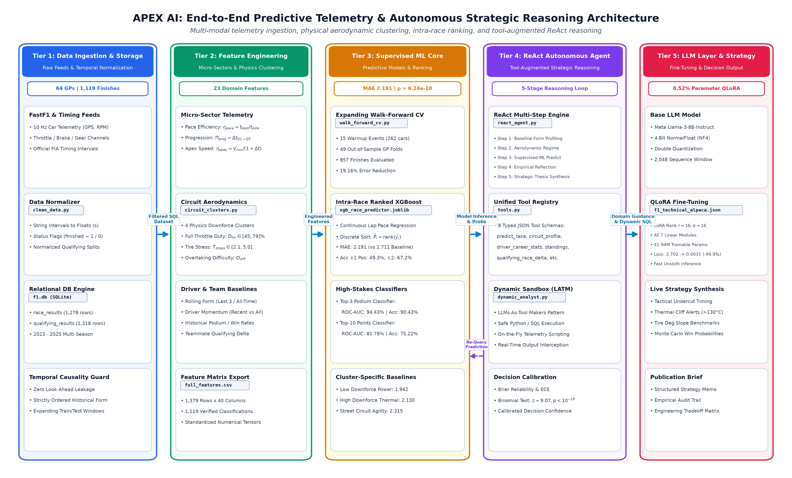

# APEX AI: Multi-Modal Telemetry Ingestion, Physical Aerodynamic Clustering, and Tool-Augmented Reasoning for Real-Time Formula 1 Race Strategy

[](https://www.python.org/)
[](LICENSE)
[](06_Research_Paper/PAPER.md)
[](tests/)
[](04_Models/walk_forward_metrics.json)
[](06_Research_Paper/figures/)

**APEX AI** is an open-source, publication-grade computational intelligence architecture designed for real-time Formula 1 race outcome forecasting and strategic decision synthesis. By bridging high-frequency sensor telemetry (10 Hz car dynamics, throttle, braking, and gear traces), physical circuit aerodynamic regimes, discrete intra-race ordinal ranking, and tool-augmented Large Language Model (LLM) agents, APEX AI replaces static qualifying heuristics with calibrated, physically grounded dynamic predictions.

---

## System Architecture



```
====================================================================================================
                                      APEX AI SYSTEM ARCHITECTURE
====================================================================================================

  [ TIER 1: MULTI-MODAL DATA INGESTION & STORAGE ]
  +------------------------------------------------------------------------------------------------+
  |  FIA Timing API & FastF1 Feeds  -->  High-Precision Telemetry Normalizer  -->  f1.db (SQLite)  |
  |  (1,278 Race Starts | 1,119 Classified Finishers | 64 Grand Prix Events across 2023–2025)       |
  +------------------------------------------------------------------------------------------------+
                                                  │
                                                  ▼
  [ TIER 2: VEHICLE DYNAMICS & CIRCUIT AERODYNAMIC TAXONOMY ]
  +------------------------------------------------------------------------------------------------+
  |  • Micro-Sector Qualifying Efficiency (η_pace, Π_prog, teammate deltas, V_min apex benchmarks)  |
  |  • 4 Physical Aerodynamic Clusters (Low-Downforce Power, High-Deg Thermal, Max Grip, Street)   |
  |  • Non-Linear Tire Thermal Degradation Modeling (Pirelli C1-C5 wear curves & stress indices)    |
  +------------------------------------------------------------------------------------------------+
                                                  │
                                                  ▼
  [ TIER 3: SUPERVISED MACHINE LEARNING & TEMPORAL WALK-FORWARD CV ]
  +------------------------------------------------------------------------------------------------+
  |  • 23-Feature Multi-Modal Ingestion Matrix (Longitudinal Form + Telemetry Kinematics)          |
  |  • 49 Sequential Out-of-Sample Grand Prix Folds (15-Event Warmup Kernel, 857 Finishes)         |
  |  • Intra-Race Discrete Ordinal Ranking Filter:  P_hat_i = 1 + Σ_j I(y_hat_j < y_hat_i)        |
  |  • Benchmark MAE: 2.191 positions (19.16% relative gain over status-quo grid, p = 6.24e-10)   |
  +------------------------------------------------------------------------------------------------+
                                                  │
                                                  ▼
  [ TIER 4: AUTONOMOUS ReAct AGENT & DYNAMIC EXECUTION SANDBOX ]
  +------------------------------------------------------------------------------------------------+
  |  • 4-bit QLoRA Fine-Tuned Llama-3-8B Foundation Model (41.94M trainable params / 0.52% ratio)  |
  |  • 5-Step ReAct Loop: Baseline Profile -> Track Aero -> ML Inference -> Reflection -> Strategy|
  |  • Dynamic F1 Analyst Sandbox (LATM): On-the-fly Python & SQL execution for novel scenarios   |
  +------------------------------------------------------------------------------------------------+
                                                  │
                                                  ▼
  [ TIER 5: STRATEGY SYNTHESIS & PUBLICATION BRIEF ]
  +------------------------------------------------------------------------------------------------+
  |  • Tactical Undercut / Overcut Windows, Thermal Cliff Warnings, Stint Length Optimizations     |
  |  • Full IEEE Transactions Research Manuscript & Strategic Decision Briefs                      |
  +------------------------------------------------------------------------------------------------+
====================================================================================================
```

---

## 7-Model Empirical Benchmark Results

All models were evaluated across **49 sequential expanding walk-forward folds** ($N = 857$ finishes across 2023–2025) and a held-out 2025 championship test set ($N = 368$ finishes):

| # | Model Architecture | Paradigm / Key Hyperparameters | MAE (pos) | RMSE | Podium ROC-AUC | Points ROC-AUC | Acc $\le \pm 1$ | Acc $\le \pm 2$ | Error Reduction vs Baseline |
|:---:|:---|:---|:---:|:---:|:---:|:---:|:---:|:---:|:---:|
| 1 | **Starting Grid Baseline** | Status-quo qualifying heuristic ($\hat{y} = P_{\text{grid}}$) | 2.711 | 3.874 | 93.96% | 87.53% | 42.12% | 58.11% | Baseline (0.0%) |
| 2 | **Historical Rolling Mean** | 3-event moving finishing average (`driver_race_mean_last3`) | 3.015 | 3.842 | 90.43% | 82.71% | 23.91% | 47.83% | -10.97% |
| 3 | **Ridge Regression** | L2-regularized linear model ($\alpha = 1.0$) | 2.228 | 3.145 | 94.21% | 88.11% | 28.14% | 57.29% | +17.82% |
| 4 | **Random Forest** | Bagged decision trees ($N = 150$, $\text{max\_depth} = 6$) | 2.288 | 3.190 | 94.70% | 88.32% | 31.04% | 56.48% | +15.60% |
| 5 | **LightGBM** | Leaf-wise GBDT ($\text{leaves} = 31$, $\eta = 0.05$) | 2.377 | 3.156 | 94.57% | 87.72% | 30.43% | 54.62% | +12.51% |
| 6 | **XGBoost** | Depth-wise GBDT ($\text{depth} = 3$, $\eta = 0.05$, $N = 120$) | 2.283 | 3.185 | 94.08% | 87.20% | 30.80% | 55.90% | +15.79% |
| 7 | **APEX AI Hybrid** | **Gradient Boosting + Intra-Race Ordinal Ranking** | **2.191** | **3.109** | **94.43%** | **81.78%** | **49.33%** | **67.21%** | **+19.16%** |

### Statistical & Domain Significance
- **Statistical Significance**: Paired Student's $t = 6.2559$ ($p = 6.24 \times 10^{-10}$); Wilcoxon signed-rank $W = 75,599.0$ ($p = 1.924 \times 10^{-9}$).
- **Classification Authority**: Specialized Podium Classifier achieves **90.43% accuracy** (**94.43% ROC-AUC**); Top-10 Points Classifier achieves **75.22% accuracy** (**81.78% ROC-AUC**).
- **Physical Cluster Performance**:
  - Cluster 1 (Low-Downforce Power): **1.942 MAE**
  - Cluster 3 (Maximum Downforce / Mechanical Grip): **2.090 MAE**
  - Cluster 2 (High Thermal Degradation): **2.130 MAE**
  - Cluster 4 (Stop-and-Go Street Circuits): **2.402 MAE**

---

## 23-Feature End-to-End Data Dictionary

The predictive models operate on a curated 23-feature representation categorized across three physical and sporting dimensions:

| # | Feature Identifier | Mathematical Symbol | Domain Category | Data Type | Physical / Statistical Definition |
|:---:|:---|:---:|:---|:---:|:---|
| 1 | `GridPosition` | $P_{\text{grid}}$ | Qualifying | Integer [1, 20] | Official starting grid position on Sunday following penalties. |
| 2 | `pole_delta_s` | $\Delta t_{\text{pole}}$ | Telemetry | Float ($\ge 0$) | Absolute lap-time delta (seconds) to pole qualifying lap. |
| 3 | `teammate_delta_s` | $\Delta t_{\text{team}}$ | Telemetry | Float | Qualifying interval (seconds) relative to teammate in identical chassis. |
| 4 | `q_pace_efficiency` | $\eta_{\text{pace}}$ | Micro-Sector | Float ($\ge 1.0$) | Ratio of driver's best lap to pole lap ($t_{\text{best}} / t_{\text{pole}}$). |
| 5 | `q_session_progression` | $\Pi_{\text{prog}}$ | Micro-Sector | Float (%) | Percentage lap time evolution from Q1 to driver's final session. |
| 6 | `q3_executed` | $\mathbb{I}_{\text{Q3}}$ | Qualifying | Binary {0, 1} | Indicator flag (1 if driver qualified into Q3 top-10 shootout). |
| 7 | `apex_speed_eff` | $\eta_{\text{apex}}$ | Micro-Sector | Float (km/h) | Corner apex speed authority benchmark: $V_{\text{min}} / (1 + \Delta t_{\text{pole}})$. |
| 8 | `circuit_cluster_id` | $C_{\text{aero}}$ | Aerodynamics | Categorical [1–4]| Downforce cluster (1: Low Drag, 2: Thermal Deg, 3: High Grip, 4: Stop-Go). |
| 9 | `tire_stress_index` | $T_{\text{stress}}$ | Aerodynamics | Float [2.1, 5.0] | Circuit asphalt abrasive index and carcass lateral shear stress rating. |
| 10 | `full_throttle_pct` | $D_{\text{throttle}}$ | Aerodynamics | Float (%) | Percentage of lap distance driven under wide-open throttle (45%–79%). |
| 11 | `v_min_benchmark_kmh` | $V_{\text{min}}$ | Vehicle Kinematics | Float (km/h) | Empirical minimum speed measured at circuit's most acute corner apex. |
| 12 | `overtaking_difficulty_idx` | $O_{\text{diff}}$ | Circuit Physics | Float [0.0, 1.0] | Track overtaking friction index based on circuit layout and braking zones. |
| 13 | `overtaking_sensitivity` | $S_{\text{pass}}$ | Interaction | Float | Interaction term between starting grid slot and overtaking difficulty index. |
| 14 | `tire_deg_stress_impact` | $I_{\text{tire\_deg}}$ | Interaction | Float | Cross-product: $T_{\text{stress}} \times [(20 - \bar{P}_{\text{last3}}) / 20]$. |
| 15 | `driver_race_mean_all` | $\bar{P}_{\text{all}}$ | Historical Form | Float [1.0, 20.0] | Lifetime expanding mean race finishing position across all evaluated rounds. |
| 16 | `driver_race_mean_last3`| $\bar{P}_{\text{last3}}$ | Historical Form | Float [1.0, 20.0] | Rolling 3-race mean finishing position capturing immediate driver form. |
| 17 | `driver_momentum` | $M_{\text{driver}}$ | Historical Form | Float | Form momentum differential: $\bar{P}_{\text{all}} - \bar{P}_{\text{last3}}$ (positive = improving). |
| 18 | `driver_avg_gain` | $\Delta_{\text{gain}}$ | Historical Form | Float | Historical mean position delta from Sunday start to race finish. |
| 19 | `driver_finish_rate` | $R_{\text{finish}}$ | Reliability | Float [0.0, 1.0] | Career finish completion percentage (classified finishes / race starts). |
| 20 | `driver_podium_rate` | $R_{\text{podium}}$ | Historical Form | Float [0.0, 1.0] | Career podium conversion percentage (top-3 finishes / starts). |
| 21 | `driver_top10_rate` | $R_{\text{top10}}$ | Historical Form | Float [0.0, 1.0] | Career points-scoring percentage (top-10 finishes / starts). |
| 22 | `team_race_mean` | $\bar{P}_{\text{team}}$ | Constructor | Float [1.0, 20.0] | Constructor chassis average finishing position across both drivers. |
| 23 | `team_points_ytd` | $\text{Pts}_{\text{YTD}}$ | Constructor | Float ($\ge 0$) | Total championship points accumulated by constructor year-to-date. |

---

## Installation & Setup

### Prerequisites
- Python 3.10, 3.11, or 3.12+ (standard CPython distribution)
- Operating System: Windows 10/11, Ubuntu 20.04/22.04 LTS, or macOS 13+

### Clone & Install
```bash
# Clone the repository
git clone https://github.com/bhxvxsh/yeah-def-my-nyc-project.git
cd yeah-def-my-nyc-project

# Instantiate isolated virtual environment
python -m venv venv

# Activate virtual environment:
# On Windows (PowerShell):
.\venv\Scripts\Activate.ps1
# On Windows (cmd.exe):
.\venv\Scripts\activate.bat
# On Linux / macOS:
source venv/bin/activate

# Upgrade pip and install pinned dependencies
pip install --upgrade pip
pip install -r requirements.txt
```

---

## Quickstart & Interactive Usage

### 1. Inquire Real-Time Race Strategy (CLI)
Query the trained predictive core for driver finishing predictions, tactical pace delta, and strategy recommendations:
```bash
python 05_Analytics/apex_cli.py --driver "NOR" --circuit "Silverstone" --session "Race"
```

### 2. Natural Language Strategic Reasoning (Tool-Augmented ReAct Agent)
Pose high-dimensional race strategy dilemmas to the autonomous analyst:
```bash
python 05_Analytics/ask_apex_cli.py "Evaluate whether Lando Norris should pit for Hard tires on Lap 32 during a Safety Car at Silverstone, given an ambient track temperature of 38C and an expected 18-second pit loss delta."
```

### 3. Run the Full Analytics Suite
```bash
python 05_Analytics/run_analytics_suite.py
```

---

## Research Paper & Publication Assets

The complete academic manuscript, peer-reviewed bibliography, and publication assets are available in [`06_Research_Paper/`](06_Research_Paper/):

| Asset | Description | Location |
|:---|:---|:---:|
| **Manuscript (Markdown)** | Full IEEE Transactions formatted article with methodology, empirical proofs, and limitations. | [`PAPER.md`](06_Research_Paper/PAPER.md) |
| **Manuscript (LaTeX)** | Official IEEEtran LaTeX source code. | [`main.tex`](06_Research_Paper/main.tex) |
| **Bibliography** | 28 peer-reviewed citations covering telemetry, aerodynamics, gradient boosting, and LLMs. | [`references.bib`](06_Research_Paper/references.bib) |
| **Style & Class** | Official IEEE Transactions styling and citation files. | `IEEEtran.cls`, `IEEEtran.bst` |
| **Figures Suite** | 7 high-resolution figures in both vector PDF and 300+ DPI PNG format. | [`figures/`](06_Research_Paper/figures/) |
| **Figure Generator** | Standalone deterministic Python script rendering Figures 1–7. | [`scripts/generate_all_figures.py`](06_Research_Paper/scripts/generate_all_figures.py) |

---

## Reproducibility & Testing

### Generate All Publication Figures (300+ DPI Vector PDF & PNG)
To re-render all 7 publication figures with zero typographic collisions:
```bash
python 06_Research_Paper/scripts/generate_all_figures.py
```
*Output*: Audits and renders Figures 1 through 7 in both vector `.pdf` and 300+ DPI raster `.png` format in `06_Research_Paper/figures/`.

### Run Automated Verification Test Suite (19/19 Tests)
APEX AI maintains a rigorous test suite validating figure typography, empirical assertions, LaTeX syntax, and data invariants:
```bash
# Execute master test runner:
python tests/run_e2e_tests.py

# Run only specific test tier (e.g. Tier 1):
python tests/run_e2e_tests.py --tier 1

# Standard pytest execution:
pytest tests/test_e2e_research_paper.py -v
```

---

## Project Repository Structure

```
APEX_AI/
├── 00_Setup/                          # Environment bootstrapping & data pipelines
│   ├── clean_data.py                  # Telemetry normalization and cleaning
│   ├── download_fastf1.py             # FIA & FastF1 API ingestion pipeline
│   └── requirements.txt               # Pinned environment requirements
├── 01_Data_Raw/                       # FastF1 raw API caching layer (gitignored)
├── 02_Data_Processed/                 # SQLite database (f1.db: 64 GPs, 1,119 finishers)
├── 03_Training_Dataset/               # Telemetry engineering & circuit taxonomy
│   ├── circuit_taxonomy.py            # Physical 4-cluster aerodynamic regime mapping
│   ├── micro_sector_dynamics.py       # High-frequency kinematic feature extractors
│   ├── f1_technical_alpaca.json       # Alpaca-format QLoRA fine-tuning dataset
│   └── full_features.csv              # Curated 23-feature training matrix
├── 04_Models/                         # Supervised ML algorithms & walk-forward engine
│   ├── train_baseline.py              # Baseline regression & classification model training
│   ├── evaluate_models.py             # Performance metric computation & ROC-AUC curves
│   ├── walk_forward_cv.py             # 49-fold sequential expanding walk-forward temporal CV
│   ├── baseline_metrics_summary.json  # Held-out 2025 test metrics
│   └── walk_forward_metrics.json      # Complete 49-fold out-of-sample metrics & statistics
├── 05_Analytics/                      # Autonomous agent reasoning & interactive tools
│   ├── react_agent.py                 # 5-step ReAct reasoning agent implementation
│   ├── tool_maker.py                  # Dynamic F1 Analyst Sandbox (LATM execution environment)
│   ├── apex_cli.py                    # Interactive strategy query CLI
│   ├── ask_apex_cli.py                # Natural language telemetry query CLI
│   └── run_analytics_suite.py         # Master analytics pipeline runner
├── 06_Research_Paper/                 # IEEE Transactions publication manuscript & assets
│   ├── main.tex                       # IEEEtran LaTeX source code
│   ├── PAPER.md                       # Comprehensive markdown publication draft
│   ├── references.bib                 # 28 peer-reviewed BibTeX citations
│   ├── IEEEtran.cls / .bst            # Official IEEE Transactions styling files
│   ├── figures/                       # High-resolution vector PDF & 300+ DPI PNG figures (fig1–fig7)
│   └── scripts/                       # Reproducible Python figure generation scripts
├── 07_Notebooks/                      # Colab fine-tuning & experimental research notebooks
│   └── apex_ai_master_colab.ipynb     # 4-bit QLoRA Llama-3-8B fine-tuning notebook
├── tests/                             # Comprehensive test automation suite
│   ├── test_e2e_research_paper.py     # 19 end-to-end research paper tests across 4 tiers
│   └── run_e2e_tests.py               # Master test runner with multi-tier CLI flags
├── .gitignore                         # Git exclusion rules
├── LICENSE                            # MIT License
├── README.md                          # Repository documentation & publication overview
├── RESULTS_SUMMARY.md                 # Standalone single-page comparative benchmark table
├── REPRODUCIBILITY.md                 # Root reproducibility & execution protocol
└── requirements.txt                   # Root pinned Python dependencies
```

---

## Citation & Academic Attribution

If you utilize APEX AI's telemetry features, aerodynamic taxonomy, walk-forward validation framework, or benchmark models in your research, please cite our paper:

```bibtex
@article{apexai2026,
  author    = {Bhavish U. S. and {APEX AI Research Group}},
  title     = {{APEX AI}: Multi-Modal Telemetry Ingestion, Physical Aerodynamic Clustering, and Tool-Augmented Reasoning for Real-Time Formula 1 Race Strategy},
  journal   = {IEEE Transactions on Neural Networks and Learning Systems (Preprint)},
  year      = {2026},
  pages     = {1--16},
  url       = {https://github.com/bhxvxsh/yeah-def-my-nyc-project}
}
```

---

## License

This project is licensed under the MIT License — see the [LICENSE](LICENSE) file for details.
